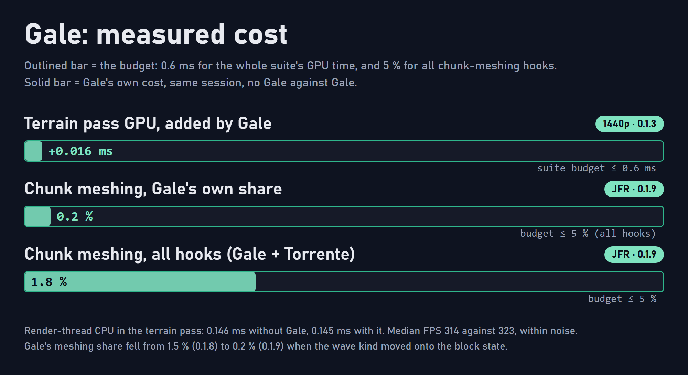

<p align="center">
  
</p>

# Gale

Gale is the wind mod of the [Atmosphera](https://github.com/SolarBiscuit/Atmosphera) suite for Minecraft 1.20.1 on Forge. Leaves, plants, hanging blocks and water plants sway with one shared, weather-driven wind, **without a shaderpack**: the motion is computed in the terrain shaders the game already runs, with nothing added to the frame's geometry.

> **Client-only.** Gale is never required on a server and never blocks joining one. It needs [AtmospheraLib](https://github.com/SolarBiscuit/AtmospheraLib), and it steps aside when a shaderpack replaces the terrain shaders.

## Features

This is the feature set Gale will have when its [roadmap](#roadmap) is complete. Items marked † are open design questions: each ends in a written go/no-go and ships only if it passes.

### Wind

- **One wind for the whole world.** A deterministic sum of sines driven by the shared clock, strengthened by rain and thunder, and layered with biome openness and altitude. Every sway frequency completes a whole number of cycles per wrap, so there is never a visible jump.
- **A wind other mods can read.** The wind is available on the CPU, so particles, falling leaves and weather mods can follow the same wind that moves the trees. Torrente's waves line up with it.
- **Rain that leans.** Rain streaks tilt with the wind.

### Foliage and plants

- **Leaves, plants and water plants** each get their own sway class, anchored at the base so a block never leaves its root.
- **Leaf flutter.** Leaves near the camera flicker slightly in the light, as if turning in the wind, kept below 10 Hz so it never reads as flicker.
- **Distant foliage.** LODs get the same offset in the transition band, a fade by pixel footprint, and a canopy shimmer beyond it.
- **Entity bending.** Grass and flowers bend away from nearby moving entities with a smooth radial falloff, and can spring back over time.
- **Shelter.** Plants under canopies and roofs, or deep in valleys, sway less, using the world's own column data.

### Hanging blocks

- **Swing like real objects.** Lanterns, chains, vines, weeping and cave vines, and hanging roots respond to the wind as driven, damped oscillators: they lag a gust, overshoot and settle, and their quick flutter fades while the slow swing grows.
- **Chain lever arm†.** Long chains and vines swing more the further they hang from their anchor, with a depth rule that is identical on both sides of a chunk-section boundary.

### Everything else

- **Per-class tuning.** Sway amount and speed, hanging swing and leaf flutter are separate options, and most apply live.
- **Shaderpack aware.** When a shaderpack replaces the terrain programs, Gale turns its features off and logs why, while the wind itself keeps running for other mods.
- **No cost at meshing.** A block's wave class is cached on the block state, so the whole feature is a field read when chunks are built.

## Performance

Gale adds almost nothing to a frame. Its budgets are the suite's: **0.6 ms of GPU time in total for every Atmosphera mod at 1440p**, 0.1 ms of render-thread CPU per frame, and at most 5 % of chunk meshing for all hooks together.

<p align="center">
  
</p>

The figures below are the project's own measurements, taken with the in-repo scenes and tools on the RatPack 2.9 test client, an RX 7900 XTX, at 2560x1440 uncapped, with a 64 x 64 field of grass, vines and two-layer oak canopy. **Only AMD hardware has been tested.** Anything that may behave differently on NVIDIA or Intel is unverified.

| Metric | Result |
|---|---|
| **Frame rate**, without Gale / with Gale (0.1.3) | 314 / 323 fps median (GPU-bound, within noise) |
| **GPU**, terrain pass | +0.016 ms (0.254 → 0.270 ms); GPU frame span 3.18 → 3.14 ms (within noise) |
| **Sync** | no OpenGL calls of its own; the wind is one `vec4` per frame |
| **CPU**, terrain pass, render thread | 0.146 → 0.145 ms (no change) |
| **CPU**, chunk meshing | Gale's own share 1.5 % → **0.2 %** (0.1.8 → 0.1.9); all Atmosphera hooks together 1.8 %, against the 5 % budget |

## Roadmap

| Release | Theme | Content |
|---|---|---|
| 0.1.x | Foundation | Weather-driven wind, sway for leaves, plants and hanging blocks, LOD canopy, cheaper meshing |
| 0.2.x | Response (**current: 0.2.1**) | Hanging blocks as oscillators, leaf flutter, wind axes from AtmospheraLib |
| 0.3.0 | Contact | Entity bending, shelter from the column field, chain lever arm† |
| 0.4.0 | Weather | Rain streaks that lean with the wind |

Bridges for Falling Leaves Forged and Atmospherics are small changes in those mods and are tracked outside this repository. Dates are not promised. Each feature release is a minor version (0.X.0). Version 1.0.0 is only used when the project is declared complete.

## Requirements

- Minecraft **1.20.1** with Forge **47.x**
- Java **17** or newer
- [AtmospheraLib](https://github.com/SolarBiscuit/AtmospheraLib) **0.6.1** or newer
- An Embeddium-based terrain renderer (developed and tested with Xenon 0.3.31)

## Installation

1. Install AtmospheraLib and an Embeddium-based terrain renderer.
2. Place `gale-<version>-mc1.20.1-forge.jar` in `mods`.
3. Options are in the Atmosphera tab of Video Settings, and in `config/SolConfig/atmosphera/`.

## Building

```bash
./gradlew :Gale:build
```

Gale builds from the Atmosphera Gradle multi-project: the four repositories checked out side by side under one root that holds `settings.gradle`, `gradle.properties` and the wrapper. It needs a JDK 17 and writes `Gale/build/libs/gale-<version>-mc1.20.1-forge.jar`.

## Licence and attribution

- Gale is licensed under the **GNU General Public License v3.0 only** ([`LICENSE`](LICENSE)). Copyright (C) 2026 SolarBiscuit.
- Additional terms under GPL-3.0 section 7 are in [`NOTICE`](NOTICE). Every copy or substantial portion that you distribute, original or modified, must keep that notice and credit "SolarBiscuit" with a link to <https://github.com/SolarBiscuit/Gale>. A modified version must be clearly marked as modified, and must not be presented as the original work or under its name and author without that marking.
- The Gale jar bundles no third-party libraries. It is built against Minecraft, Forge and AtmospheraLib, which are not redistributed with it.
- Gale is an independent project. It is not affiliated with, endorsed by, or supported by Mojang Studios, Microsoft, Minecraft Forge or the authors of the mods it works with.

## Reporting issues

Issues belong in the [Gale issue tracker](https://github.com/SolarBiscuit/Gale/issues). Please include the Gale and AtmospheraLib versions, your renderer and shaderpack (if any), your GPU and driver, and `latest.log`. The output of `/atmosphera status` helps.
